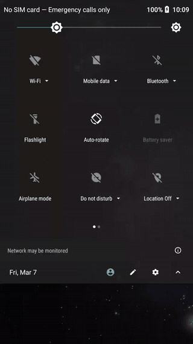
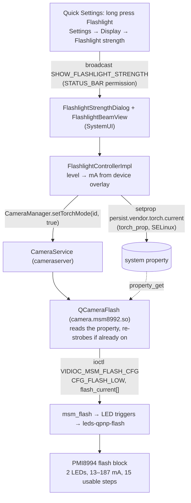

# Nexus 5X flashlight strength

<p align="center">
  
  <br>
  <sub>Long press on the Flashlight tile, then drag the beam. <a href="media/demo.mp4">Full-quality video</a></sub>
</p>

A flashlight brightness control for the **Nexus 5X (bullhead)** running **LineageOS 15.1
(Android 8.1)**, modelled on the "Flashlight Strength" dialog in newer Android releases: long press
the Quick Settings Flashlight tile, or open **Settings → Display → Flashlight strength**, and drag
the light beam.

Android 8.1 has no API for torch brightness (it arrived in Android 13), and neither does the
Lineage SDK. The hardware supports it, though: the PMI8994 flash driver takes the torch current in
mA, with 16 hardware steps. This project connects that to the UI with as little code as possible,
**without touching the kernel**.


## Architecture



| Layer | What changed | Where | Details |
|---|---|---|---|
| Kernel | Nothing. Analysis of what `leds-qpnp-flash` / `msm_flash` already support, and three findings | `kernel/lge/bullhead` | [docs/01](docs/01-hardware-and-driver.md) |
| Camera HAL | Torch current read from `persist.vendor.torch.current`; re-applied live with a strobe off→on | `device/lge/bullhead/camera` | [docs/02](docs/02-camera-hal-and-sepolicy.md) |
| SELinux | `torch_prop`: SystemUI may set it, the camera HAL may read it | `device/lge/bullhead/sepolicy` | [docs/02](docs/02-camera-hal-and-sepolicy.md) |
| Overlay | The 15 torch currents, one per level | `device/lge/bullhead/overlay` | [docs/02](docs/02-camera-hal-and-sepolicy.md) |
| SystemUI | Flashlight Strength dialog, beam slider, long press on the tile, strength levels in `FlashlightController` | `frameworks/base/packages/SystemUI` | [docs/03](docs/03-systemui-and-settings.md) |
| Settings | Display → Flashlight strength, opens the same dialog | `packages/apps/Settings` | [docs/03](docs/03-systemui-and-settings.md) |

## Findings

1. **The hardware and driver already support it.** In `leds-qpnp-flash` the torch LEDs' brightness
   *is* the current in mA (13–200 mA, 4-bit register → 16 steps). The camera HAL passes the current
   to `msm_flash` in every `CFG_FLASH_LOW` ioctl.
2. **The stock torch ran at 127 mA, not 200 mA.** The bullhead HAL always asked for 200 mA, but
   `msm_flash_low()` only accepts values *below* the 200 mA DT maximum and silently falls back to
   `LED_HALF`. The highest step reachable from userspace is 187 mA.
3. **The PMIC latches the torch current only when the strobe turns on.** Writing a new current
   while the torch is on updates the registers (checked through SPMI debugfs) but not the light.
   The HAL now strobes off and on again.
4. **The driver merges a back-to-back off and on.** `leds-qpnp-flash` switches the LEDs from a
   workqueue. If the "on" arrives before the "off" work has run, the off is lost, so live changes
   only worked some of the time. The HAL now waits 10 ms between the two, and SystemUI only sends
   the latest level while you drag.

Details, with register dumps: [docs/01-hardware-and-driver.md](docs/01-hardware-and-driver.md).

## Repository layout

```
patches/                    git format-patch series, one folder per repo project
  device_lge_bullhead/        3 patches: camera HAL, SELinux, overlay
  frameworks_base/            1 patch: SystemUI dialog
  packages_apps_Settings/     1 patch: Display settings entry
manifest-pinned.xml         repo manifest with the exact revisions the patches apply to
docs/                       one write-up per layer + how it was tested
media/                      demo GIF, muted MP4, screenshots
```

The patches are independent of my other bullhead projects
([nexus5x-rgbled](https://github.com/kaiwalyakhasnis/nexus5x-rgbled),
[nexus5x-recovery-roadfighter](https://github.com/kaiwalyakhasnis/nexus5x-recovery-roadfighter)) and apply to
a clean tree.

## Reproducing it

You need a LineageOS 15.1 tree for bullhead. See the
[LineageOS bullhead build guide](https://wiki.lineageos.org/devices/bullhead/build); the 15.1 branch
is archived, so expect some fighting with a modern host.

```bash
# 1. Sync to the same revisions the patches were made on
repo init -u https://github.com/LineageOS/android.git -b lineage-15.1
cp manifest-pinned.xml .repo/manifests/pinned.xml
repo init -m pinned.xml && repo sync -c -j8

# 2. Apply the patches (from the root of the tree)
for p in device_lge_bullhead:device/lge/bullhead \
         frameworks_base:frameworks/base \
         packages_apps_Settings:packages/apps/Settings; do
    git -C "${p#*:}" am "$PWD/../nexus5x-flashlight-strength/patches/${p%%:*}"/*.patch
done

# 3. Build
source build/envsetup.sh
lunch lineage_bullhead-userdebug
m -j6 bacon                 # flashable zip
```

To try it without flashing anything, build only the changed modules and RAM-boot the boot image:
see [docs/04-testing-without-flashing.md](docs/04-testing-without-flashing.md).

Check that it works:

```bash
adb shell dumpsys activity service com.android.systemui/.SystemUIService | grep strengthLevel
adb shell getprop persist.vendor.torch.current
adb shell cat /sys/class/leds/led:torch_0/brightness     # mA the driver got
```

## Known limitations

- Each strength change while the torch is on switches it off for about 10 ms. A kernel patch that
  pulses only the strobe bit would make this shorter, but the kernel was left untouched on purpose.
- The top step is 187 mA, not 200 mA (finding 2). Reaching 200 mA needs a one-character change in
  `msm_flash_low()` (`<` → `<=`).
- Both LEDs always get the same current.
- Only torch mode is affected. The camera app's flash during capture goes through the mm-camera
  daemon.
- Tested by RAM-booting the boot image and bind-mounting the new files
  ([docs/04](docs/04-testing-without-flashing.md)), not from a flashed zip. The Settings entry
  builds but wasn't opened on the phone, because the test phone was pattern-locked. The dialog it
  opens was tested through the same broadcast.
- The register values were checked through debugfs, but whether the light actually changes can
  only be checked by eye: no sensor on the phone faces the rear flash.

## License

- Camera HAL patch (`QCameraFlash`): BSD-3-Clause, like the Qualcomm QCamera2 code it modifies.
- Everything else (SELinux policy, overlay, SystemUI, Settings): Apache-2.0, like AOSP and LineageOS.
