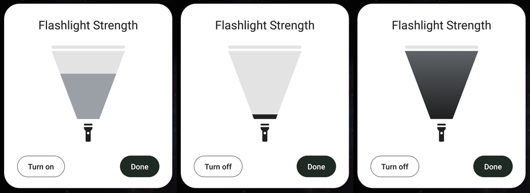

# 3. SystemUI dialog and Settings entry

Patches: [`patches/frameworks_base/`](../patches/frameworks_base/),
[`patches/packages_apps_Settings/`](../patches/packages_apps_Settings/)

## The design it copies

Android 16 added a flashlight strength control to Quick Settings. In the Android Canary 2510 build
the Flashlight tile opens a **"Flashlight Strength"** dialog with a vertical slider drawn like a
light beam coming out of a flashlight
([Android Authority](https://www.androidauthority.com/android-flashlight-brightness-design-3608998/)):

- white dialog with large rounded corners, title centered at the top
- a cone that is narrow at the bottom and wide at the top, with a light "lens" bar above it
- a flashlight icon under the cone
- the cone fills from the bottom up to the current strength
- an outlined **Turn off** button bottom left, a filled **Done** button bottom right



## Files

```
packages/SystemUI/
  src/com/android/systemui/flashlight/
    FlashlightBeamView.java          the cone slider (custom View)
    FlashlightStrengthDialog.java    the dialog (SystemUIDialog)
    FlashlightStrengthReceiver.java  opens the dialog for Settings
  src/.../qs/tiles/FlashlightTile.java                 long press -> dialog
  src/.../statusbar/policy/FlashlightController.java   + get/setStrengthLevel, getMaxStrengthLevel
  src/.../statusbar/policy/FlashlightControllerImpl.java
  res/layout/flashlight_strength_dialog.xml
  res/drawable/flashlight_strength_{dialog_bg,button_outline,button_filled}.xml
  res/values/{lineage_config,lineage_colors,lineage_dimens,cm_strings,styles}.xml
```

## FlashlightController: levels, not milliamps

SystemUI doesn't know anything about bullhead. The controller reads three config values, which
are empty in `frameworks/base` and set by the device overlay ([02](02-camera-hal-and-sepolicy.md)):

```java
int getMaxStrengthLevel();     // config_flashlightStrengthValues.length, 0 = unsupported
int getStrengthLevel();        // highest level whose value <= the property, or the default level
void setStrengthLevel(int);    // writes the property and turns the torch on / re-applies it
```

When `getMaxStrengthLevel()` is 0, long press keeps its old behaviour (it toggles the torch), the
receiver does nothing, and Settings hides its entry. So the change is safe on devices without the
overlay.

### Dragging: only send the latest level

A drag can cross several levels quickly, and each change on the HAL side means an ioctl, a 10 ms
pause and another ioctl. `setStrengthLevel()` only records the newest level and posts one runnable
if none is pending:

```java
synchronized (this) {
    post = mPendingStrengthLevel == 0;
    mPendingStrengthLevel = level;          // overwrite, intermediate levels are dropped
}
if (post) mHandler.post(mApplyStrength);
```

`applyPendingStrength()` runs on the controller's background thread, sets the property, and calls
`setTorchMode(id, true)`, which turns the torch on or, if it's already on, makes the HAL re-read the
strength. Because the binder call blocks until the HAL is done, updates limit themselves to what
the hardware can take. Nothing is left in a queue after the finger stops.

## FlashlightBeamView

A plain `View`, drawn in `onDraw()`:

1. a rounded "lens" bar across the top
2. the cone as a `Path` (top width = view width, bottom width = 30%) in the track color
3. the same path clipped to the bottom `level / max` of its height, filled with a dark gradient
   when the torch is on, or flat gray when it's off
4. `ic_signal_flashlight` (the QS tile icon) under the cone

Touch maps the finger's Y position on the cone to a level (`ceil(fraction * max)`, at least 1).
Touching the cone also turns the torch on, as in the reference design. For TalkBack it reports
itself as a `SeekBar`, with `RangeInfo`, scroll forward/backward actions and a content description
such as "Flashlight strength 53%".

## FlashlightStrengthDialog

A `SystemUIDialog`, so it gets `TYPE_STATUS_BAR_PANEL` and shows over the notification shade and
the lock screen. Two details:

- AlertDialog's custom view slot clipped the buttons and wrapped the width to the content, so the
  title broke over two lines. The dialog calls `setContentView()` after `super.onCreate()` and sets a
  fixed width (`flashlight_strength_dialog_width`, 344dp including the 16dp inset).
- It registers as a `FlashlightListener` between `onStart()` and `onStop()`. Callbacks come on the
  controller's thread, so updates are posted to the main thread. The left button says **Turn on**
  or **Turn off** depending on the torch state, and both controls are disabled while the camera is
  in use.

## Opening it from Settings

Settings can't show a SystemUI dialog itself, so SystemUI has a receiver:

```xml
<receiver android:name=".flashlight.FlashlightStrengthReceiver"
    android:exported="true"
    android:permission="android.permission.STATUS_BAR">
    <intent-filter>
        <action android:name="com.android.systemui.action.SHOW_FLASHLIGHT_STRENGTH" />
    </intent-filter>
</receiver>
```

`STATUS_BAR` is `signature|privileged`, and Settings already holds it, so normal apps can't open
the dialog.

`FlashlightStrengthPreferenceController` adds **Settings → Display → Flashlight strength** below the
camera gesture switch. Clicking it sends the broadcast to `com.android.systemui` as the system user.
`isAvailable()` checks `FEATURE_CAMERA_FLASH` and looks up SystemUI's
`config_flashlightStrengthProperty` through `getResourcesForApplication()`, so the entry only shows
when the dialog would actually work.

## Why the dialog lives in SystemUI only

It would have been possible to put a second slider in Settings. But only one process should talk
to the torch: `CameraService` links the torch to the binder of the client that turned it on, and
turns it off when that process dies. If Settings re-applied the strength itself, closing Settings
could switch the torch off. Keeping everything in SystemUI, which is persistent, avoids that, and
both entry points show the same UI.
